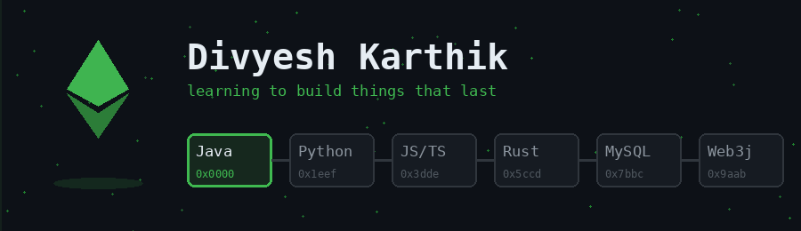

# Hey, I'm Divyesh

Second-year CS student in Pune, learning software by building it. Every language I know is a work in progress: right now that's Java, Python, JavaScript/TypeScript, Rust and MySQL.

Lately I've been poking around Ethereum open source, working toward a first PR in [Web3j](https://github.com/LFDT-web3j/web3j), the Java library for Ethereum.

## Toolbox (all in progress)

  

## Two things I've built

**[SereNova](https://github.com/Qwerty-2308/AI-Therapist)** - a conversational app that responds to what you're feeling, over text or voice. Built with a small team: React/TypeScript frontend, Spring Boot backend.

**[Social Guardrails API](https://github.com/Qwerty-2308/social-guardrails-api)** - a Spring Boot + Redis service that caps bot replies and enforces cooldowns in a social app. My excuse to find out how atomic locks and race conditions actually behave.

## Currently learning

- Java, properly: Spring Boot, concurrency, and how bigger codebases stay organized
- How Ethereum signing and clients work under the hood
- Rust, slowly and happily

[LinkedIn](https://www.linkedin.com/in/divyesh-karthik)
